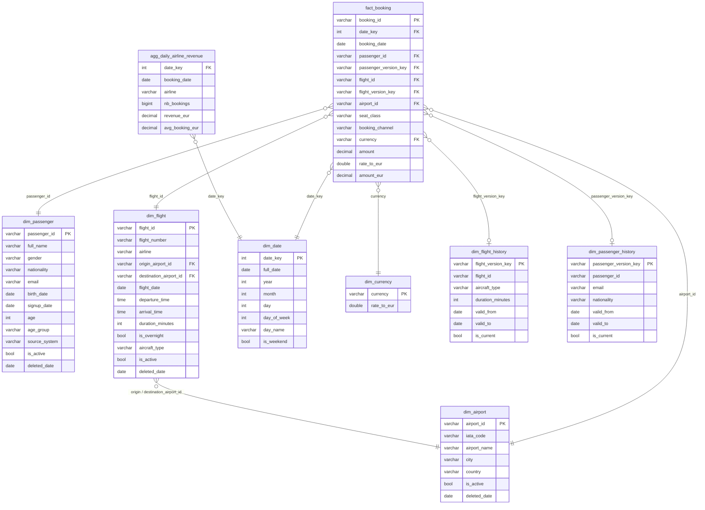

# Documentation du pipeline

Pipeline ELT quotidien en architecture médaillon (bronze / silver / gold) pour la compagnie
aérienne fictive du TP, sur les données de septembre 2025.

## Lancer le pipeline

```bash
pip install -r requirements.txt
cd ingestion
python run_month.py --full-refresh          # reconstruit l'entrepôt depuis zéro (init + 30 jours)
python run_month.py --check-idempotence     # rejoue en plus chaque jour et vérifie que rien ne bouge
```

`run_month.py` rejoue toujours le dernier jour à la fin, compare l'entrepôt avant/après (nombre
de lignes et empreinte de chaque table, colonnes techniques exclues) et échoue si quelque chose a
changé. Il affiche ensuite les comptes par table et des contrôles d'intégrité référentielle.

## Observations sur les sources

| Fichier | Clé | Contenu du fichier du jour | Évolution observée |
|---|---|---|---|
| `airports` | `airport_id` | extrait complet | quasi figé (1 correction, 1 ajout sur le mois) |
| `flights` | `flight_id` | extrait complet | 0 à 5 évènements/jour : ajouts, changements d'horaire/avion/date, suppressions |
| `passengers_en` / `_fr` | `passenger_id` / `id_passager` | extrait complet | croissance continue, corrections et suppressions rares |
| `bookings` | `booking_id` | uniquement les réservations du jour | jamais modifiées ni supprimées |
| `dim_currency` | `currency` | table de référence fournie | taux fixes |

Les deux fichiers passagers diffèrent par les noms de colonnes, les valeurs de genre
(`Male/Female` contre `Homme/Femme`) et le format des dates (`YYYY-MM-DD` contre `DD/MM/YYYY`).
Leurs identifiants ne se chevauchent pas (contrôlé à chaque chargement).

## Choix de modélisation

**Fait : `fact_booking`.** Une réservation est un évènement daté, immuable, qui porte des mesures
(`amount`, `amount_eur`) et référence les autres entités. Grain : une ligne par réservation.

**Dimensions : aéroports, vols, passagers, date.** Ce sont des référentiels qui décrivent le
contexte d'une réservation et qui évoluent dans le temps (livrés en extraits complets). Un vol
est bien un référentiel ici : il est programmé à l'avance et modifié (horaire, avion) avant
d'être réservé, il ne mesure rien. `seat_class`, `booking_channel` et `currency` sont gardés dans
le fait comme **dimensions dégénérées** : quelques valeurs sans attribut propre, une table dédiée
n'apporterait rien.

**Attributs calculés en gold :**
- `dim_flight.duration_minutes` : `arrival_time - departure_time`, + 24 h quand l'arrivée est
  « avant » le départ (vol de nuit, signalé par `is_overnight`).
- `dim_passenger.age` et `age_group` (`0-17`, `18-24`, `25-34`, `35-44`, `45-54`, `55-64`, `65+`),
  calculés à la date du dernier snapshot passagers chargé (et non à la date système, pour que la
  gold reste reproductible).
- `fact_booking.amount_eur = amount * dim_currency.rate_to_eur`.

**Agrégat : `agg_daily_airline_revenue`**, chiffre d'affaires en EUR, nombre et panier moyen des
réservations par jour de réservation et par compagnie. Il est reconstruit dans
`ingest_bookings.ingest_gold`, juste après le fait, car il en dépend (et de `dim_flight` pour la
compagnie) ; c'est pour cela que le gold des réservations passe après celui des vols.

**Bonus SCD2 :** `dim_flight_history` et `dim_passenger_history` gardent une version par état
connu, avec `valid_from` / `valid_to` (intervalle semi-ouvert, `valid_to` NULL = version
courante) et `is_current`. L'état initial (`init/`) est considéré valable depuis `1900-01-01`,
faute d'historique antérieur. `fact_booking` porte `flight_version_key` et
`passenger_version_key`, la version valable au jour de la réservation, ce qui répond à « quel
avion était affecté à ce vol quand il a été réservé ? ».

## Stratégies de chargement (silver)

| Table silver | Stratégie | Détail |
|---|---|---|
| `silver_airports` | upsert + soft delete | code fourni par le sujet, conservé tel quel |
| `silver_flights`, `silver_passengers` | upsert + soft delete | mise à jour uniquement si une valeur a changé |
| `silver_flights_history`, `silver_passengers_history` | SCD2 | fermeture des versions changées ou disparues, ouverture des nouvelles |
| `silver_bookings` | insert simple | `ON CONFLICT (booking_id) DO NOTHING` |

- **Upsert** pour les extraits complets : on insère les nouvelles clés et on met à jour les clés
  existantes. Sur flights et passengers, le `DO UPDATE` a une condition `WHERE ... IS DISTINCT
  FROM ...` : une ligne identique n'est pas retouchée, donc `update_timestamp` indique un vrai
  changement. (Le code fourni pour airports rafraîchit `update_timestamp` à chaque passage ;
  je l'ai laissé tel quel.)
- **Soft delete** : une clé absente de l'extrait du jour passe à `is_active = false` avec
  `deleted_date` = date du snapshot. Rien n'est supprimé physiquement, pour que les réservations
  passées gardent leur vol, passager ou aéroport. Une clé qui réapparaît est réactivée.
  C'est nécessaire dans ces données : 17 des 18 vols supprimés et les 7 passagers supprimés ont
  déjà des réservations, et 774 réservations pointent vers un vol inactif au 30 septembre.
- **Insert simple** pour les réservations : ce sont des évènements immuables, et le fichier du
  jour ne contient que les nouvelles. Une réservation déjà connue est ignorée.
- **Colonnes techniques** sur toutes les tables silver et gold : `insert_timestamp` (première
  apparition, jamais modifié) et `update_timestamp` (dernière modification réelle). La gold
  reprend ceux du silver ; l'agrégat prend le min/max des réservations agrégées.
- **Unification des passagers** : noms de colonnes anglais, genre ramené à `Male/Female`, dates
  typées `DATE`, email en minuscules, colonne `source_system` (`EN`/`FR`) pour la traçabilité.

## Idempotence

- **Bronze** : un fichier déjà présent n'est pas retéléchargé ; l'écriture passe par un fichier
  temporaire renommé à la fin, pour ne jamais laisser un fichier tronqué.
- **Silver** : chaque chargement est une transaction (tout ou rien) et est tracé dans
  `silver_load_log` (entité, date de snapshot, nombre de lignes). Rejouer un jour ne change rien :
  l'upsert ne retouche pas les lignes identiques, le SCD2 ne ferme ni n'ouvre de version, l'insert
  ignore les réservations connues.
- **Rejeu dans le désordre** : les extraits complets décrivent un état, donc recharger le 5
  septembre après le 30 ramènerait l'entrepôt en arrière. Un snapshot plus ancien que le dernier
  chargé est donc ignoré (avec un message). Pour rejouer tout l'historique, on repart de zéro avec
  `--full-refresh` : bronze/ contient tous les fichiers, rien n'est retéléchargé.
- **Gold** : reconstruite entièrement (`CREATE OR REPLACE`) à partir de l'état courant du silver ;
  elle ne dépend d'aucune date.

Vérifié : deux exécutions successives de `run_month.py` donnent exactement les mêmes tables
(comptes et empreintes identiques), et `--check-idempotence` passe sur les 30 jours.

## Modèle de données final (gold)



Toutes les tables silver et gold ont aussi `insert_timestamp` et `update_timestamp` (omis du
diagramme pour la lisibilité).

## Limites connues

- **Durée de vol** calculée sur des heures locales sans fuseau horaire : pour un vol qui change de
  fuseau, c'est l'écart entre heures affichées, pas la durée réelle. Un vol de plus de 24 h ne
  serait pas représentable.
- **Taux de change fixes** (`dim_currency`) : `amount_eur` n'est pas le montant au taux du jour.
- **Âge** calculé à la date du dernier snapshot : il n'est pas figé au jour de la réservation
  (l'écart est d'au plus un an sur un mois de données).
- **Rejeu d'un jour passé** ignoré pour les extraits complets ; corriger un jour ancien impose un
  `--full-refresh`.
- **Granularité SCD2 à la journée** : plusieurs changements dans une même journée ne donnent
  qu'une version (on ne voit que l'état de fin de journée).
- **Agrégat** attribué à la compagnie actuelle du vol (`dim_flight`), qui ne change pas dans ces
  données mais pourrait changer ailleurs.
- **Airports** : `update_timestamp` est rafraîchi à chaque chargement (code fourni), contrairement
  aux autres dimensions.
- **Gold reconstruite entièrement** à chaque exécution : simple et sûr à ce volume (~40 000
  réservations), à rendre incrémental sur de plus gros volumes.
- Pas d'orchestration Dagster (bonus non réalisé).
